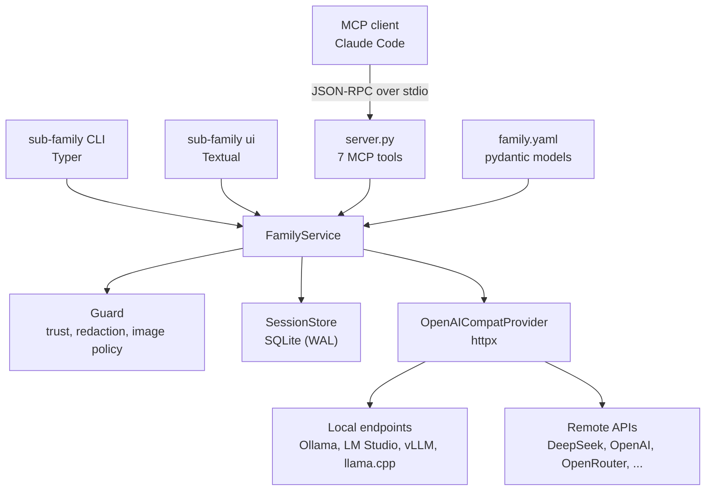
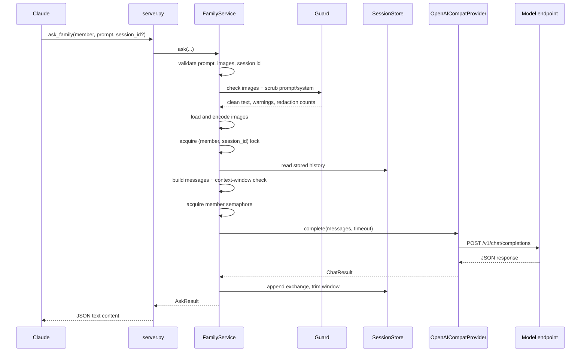

# Architecture

Sub-Family is one long-lived Python process that speaks MCP over stdio and also
ships an administrative CLI/TUI. It does not run models itself and does not
proxy a chat UI: it turns a YAML registry of OpenAI-compatible endpoints into a
small set of delegation tools, with persistent sessions and trust-aware policy
in front of every request.

## Layers



| Layer | Modules | Responsibility |
| --- | --- | --- |
| Configuration | `config/models.py`, `config/loader.py`, `config/template.py` | Strict schema, path resolution, `.env` loading, atomic saves with backups, starter YAML. |
| Providers | `providers/base.py`, `providers/openai_compat.py`, `providers/media.py` | One HTTP adapter for Chat Completions, retries and error classification, health probes, image normalisation. |
| State and policy | `sessions/store.py`, `security/guard.py` | SQLite history with sliding windows, secret redaction, hard blocks, image policy. |
| Orchestration | `service.py` | `ask`, `swarm`, `status`, session lifecycle, per-member concurrency, session locks. |
| Interfaces | `server.py`, `cli.py`, `tui/` | MCP tool surface, scriptable administration, interactive editor. |

The delegation path is strictly layered: `server.py` and the CLI call
`FamilyService`, which owns HTTP clients, sessions, and policy. Two admin paths
intentionally reach one layer down: the CLI's `sessions` commands open
`SessionStore` directly for local inspection and cleanup, and the TUI uses
`OpenAICompatProvider` for its "test member" probe. Those exceptions keep
admin-only concerns out of the long-lived server process. `FamilyService` itself
is transport-independent, which is why it can be tested without an MCP client.

## Configuration layer

`load_config()` reads YAML with `yaml.safe_load`, then validates it with pydantic
models configured with `extra="forbid"` and `frozen=True`. An unknown key such
as `max_clone` fails loudly instead of silently disabling a concurrency limit.
Validation errors are rewritten as `path: message` lines that point at the
offending field.

`load_environment()` loads `.env` from the config directory *without*
overriding variables already present in the process environment. `save_config()`
writes through a temporary file in the same directory, fsyncs, then atomically
replaces the target, keeping a `.bak` copy and setting POSIX mode `0600`.

## Provider layer

There is currently one provider implementation,
`OpenAICompatProvider`. It builds two URLs from the member configuration:

- `chat_url`: `base_url` + `/v1/chat/completions` unless the base already ends in
  `/v1` (or contains `/v1/`), already points at `/chat/completions`, or
  `chat_path` overrides the suffix.
- `models_url`: derived by replacing the `/chat/completions` suffix with
  `/models`; otherwise `base_url` + `/v1/models`.

Generation sends a non-streaming JSON body (`model`, `messages`, `stream:
false`, optional `temperature` and `max_tokens`, plus `extra_body`). Responses
are normalised to `ChatResult`; `reasoning_content` and `reasoning` are captured
but only exposed when `security.expose_reasoning` is enabled.

Retries are implemented in the provider, not in httpx. Timeouts, transport
failures, HTTP 429, 5xx, 408 and 504 are retried with exponential backoff and
jitter (`Retry-After` is honoured, capped at 30 seconds). Authentication,
not-found, and other 4xx errors are never retried because the same request
cannot succeed.

## Request flow: `ask_family`



Details that matter:

1. Prompt length is checked against `security.max_prompt_chars`; the system
   prompt (configured plus per-call) is checked and scrubbed separately.
2. Image admission checks (the `vision` capability, the remote-image policy,
   and the eight-image count) run before the provider request. Size and format
   are validated while loading the bytes, so a remote image may be downloaded
   before it is rejected; the model endpoint is never called with an invalid
   image.
3. The per-session `asyncio.Lock` serialises turns of the same
   `(member, session_id)`. Stateless calls use a no-op lock.
4. History is read *inside* the lock, so concurrent calls on one session cannot
   duplicate or reorder context. The member semaphore is acquired only around
   the provider call, not while waiting on the session lock.
5. Image bytes are sent as data URLs but only a text reference is stored in
   history.
6. A response with no final content but a reasoning trace yields a placeholder
   and a warning instead of an empty tool result. Truncation by
   `finish_reason == "length"` adds a warning.

## Request flow: `ask_family_swarm`

`swarm()` fans `ask()` out with `asyncio.gather`. Each branch is an ordinary
`ask()` call, so it still applies redaction, vision policy, history, and the
member semaphore. A branch failure is converted to a result with `ok: false`
and an `error`; it never cancels its siblings.

```text
effective_limit = min(member.max_clones,
                      max_concurrency or number_of_tasks)

if max_concurrency is set:
    outer_gate = Semaphore(effective_limit)
    branch i: async with outer_gate: await ask(...)
else:
    branch i: await ask(...)   # ask() itself waits on member semaphore
```

The outer gate is optional. When present it can only tighten the limit, never
exceed `max_clones`. Because `ask()` acquires the same member semaphore, a
fan-out can never create more concurrent generations than the member allows,
regardless of how many branches were requested.

Optional synthesis is a separate `ask()` request after all branches finish. It
is attempted only when at least two branches succeeded, and the prompt budget
is 180,000 characters split across successful outputs. Branch content returned
to the caller is truncated to `swarm.max_result_chars`.

With `session_prefix`, branch *N* (1-based) uses session
`<prefix>-<N>`, so the same index can be continued on a later swarm call. This
is how parallel audits stay isolated without inventing new ids.

## Concurrency model

| Mechanism | Scope | Purpose |
| --- | --- | --- |
| `asyncio.Semaphore(max_clones)` | One per member | Caps concurrent generation requests to a model endpoint. |
| `asyncio.Semaphore(effective_limit)` | One per swarm call | Optional tighter cap for GPU/VRAM safety. |
| `asyncio.Lock` per `(member, session_id)` | One per session | Prevents interleaved turns and lost history. |
| httpx `Limits` | One per member | Connection pool sized to `max(4, max_clones * 2)` / keep-alive `max(2, max_clones)`. |
| `threading.RLock` | One per `SessionStore` | Serialises calls into the single SQLite connection. |
| `asyncio.to_thread` | Every DB operation | Keeps SQLite I/O off the event loop. |

Semaphores are created in `FamilyService.start()`, one per member, and live for
the service lifetime. A waiting call has no queue timeout of its own: it waits
for a slot, while the HTTP request that eventually runs is bounded by
`timeout_s`. A large cloud `max_clones` therefore increases parallelism; a
local GPU should usually stay at `max_clones: 1`.

`family_status` probes `/models` directly and bypasses both the session locks
and the semaphores, so health checks never wait behind a long generation.

## Session storage

```sql
CREATE TABLE sessions (
    member        TEXT NOT NULL,
    session_id    TEXT NOT NULL,
    created_at    TEXT NOT NULL,
    updated_at    TEXT NOT NULL,
    message_count INTEGER NOT NULL DEFAULT 0,
    last_preview  TEXT NOT NULL DEFAULT '',
    PRIMARY KEY (member, session_id)
);

CREATE TABLE messages (
    id                INTEGER PRIMARY KEY AUTOINCREMENT,
    member            TEXT NOT NULL,
    session_id        TEXT NOT NULL,
    role              TEXT NOT NULL,
    content           TEXT NOT NULL,
    created_at        TEXT NOT NULL,
    prompt_tokens     INTEGER,
    completion_tokens INTEGER,
    FOREIGN KEY (member, session_id)
        REFERENCES sessions(member, session_id) ON DELETE CASCADE
);

CREATE INDEX idx_messages_session ON messages(member, session_id, id);
CREATE INDEX idx_sessions_updated ON sessions(updated_at);
```

Pragmas: `journal_mode=WAL`, `synchronous=NORMAL`, `foreign_keys=ON`,
`busy_timeout=5000`, `user_version=1`. Message content is JSON-encoded, which
lets a user message be either a string or a list of text/image parts; it is
decoded transparently on read. Upserts touch `sessions.updated_at`, and the
window is recomputed after each exchange:

1. Walk messages newest to oldest, keeping at most `sessions.max_messages`.
2. Stop before the cumulative `length(content)` exceeds `sessions.max_chars`
   (unless that would discard everything).
3. Advance the starting index until it points at a `user` message, so a
   trimmed history never begins with an orphaned assistant reply.

TTL pruning deletes sessions whose `updated_at` is older than `ttl_days`; it
runs at startup when `cleanup_on_start` is true and `ttl_days > 0`.

The store uses the synchronous `sqlite3` module wrapped in
`asyncio.to_thread`, protected by an `RLock`, rather than a second async
database dependency. At one developer's delegation volume this is simpler and
avoids an extra event-loop integration; WAL handles the small read/write
overlap of a swarm.

## MCP server surface

`server.py` creates an `MCPServer` with `SERVER_INSTRUCTIONS` and seven tools.
Tool docstrings are not comments: the MCP SDK sends them to the client as tool
descriptions, so they carry delegation policy, trust rules, and argument
semantics. Expected `SubFamilyError` failures become `ToolError` with the same
message a CLI user would see; unexpected exceptions are left to the SDK.

Successful tools return pretty-printed JSON (UTF-8, non-ASCII preserved). The
stdio server writes logs to stderr only. Stdout is reserved for JSON-RPC; a
stray print would corrupt the protocol. `configure_logging()` enforces a stderr
handler and clears other root handlers.

## Why httpx instead of a provider SDK

- **One protocol, many vendors.** Ollama, LM Studio, vLLM, llama.cpp server,
  DeepSeek, OpenRouter, and most gateways expose the same Chat Completions
  shape. A single adapter covers them without a matrix of SDKs.
- **Control over the details that matter here.** Per-member TLS verification,
  timeouts, custom auth headers, `extra_body` passthrough, and exact retry
  classification are easier with a small HTTP client than through vendor
  abstractions.
- **Fewer moving parts.** No SDK release cadence, no transitive dependency
  conflicts with the MCP SDK, and no hidden retries on top of the ones we
  implement.
- **Debuggability.** The request URL, payload, and status are explicit, which
  makes errors like a wrong `/v1` or a missing model actionable.

The cost is that non-OpenAI protocols (for example Anthropic Messages or Gemini
native) need a new adapter; they cannot be expressed by configuration alone.

## Extending

**A new OpenAI-compatible backend** needs only a registry entry: `base_url`,
`model`, optional `api_key_env`, `headers`, `chat_path`, and `extra_body`.

**A native provider** implements the `ChatProvider` protocol
(`complete()` and `health()`) and is wired through the `provider_factory`
argument of `FamilyService`. Embedders can inject it directly; for the bundled
server, `_default_provider()` in `service.py` selects the implementation. Adding
a `provider:` field to `MemberConfig` would make this configurable rather than
code-driven, but that field does not exist yet.

**A new capability** is mostly declarative: `capabilities` accepts lowercase
tokens and is not restricted to the known list. Only `vision` changes runtime
behaviour today (image admission). Gating another capability requires a policy
check in `FamilyService` and, for good UX, adding the name to
`KNOWN_CAPABILITIES` so the TUI can offer it.

**A new MCP tool** is a thin `@server.tool()` method that delegates to the
service, returns JSON, and converts `SubFamilyError` to `ToolError`. Update the
tool table in the README, the tests in `tests/test_server.py`, and any client
guidance that should mention the tool.

## Further reading

- [Configuration reference](configuration.md)
- [Security model](security.md)
- [Claude Code integration](claude-code.md)
